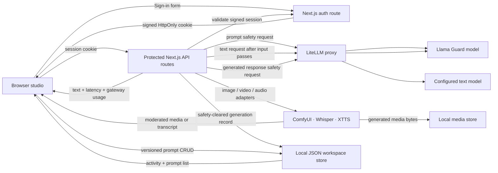
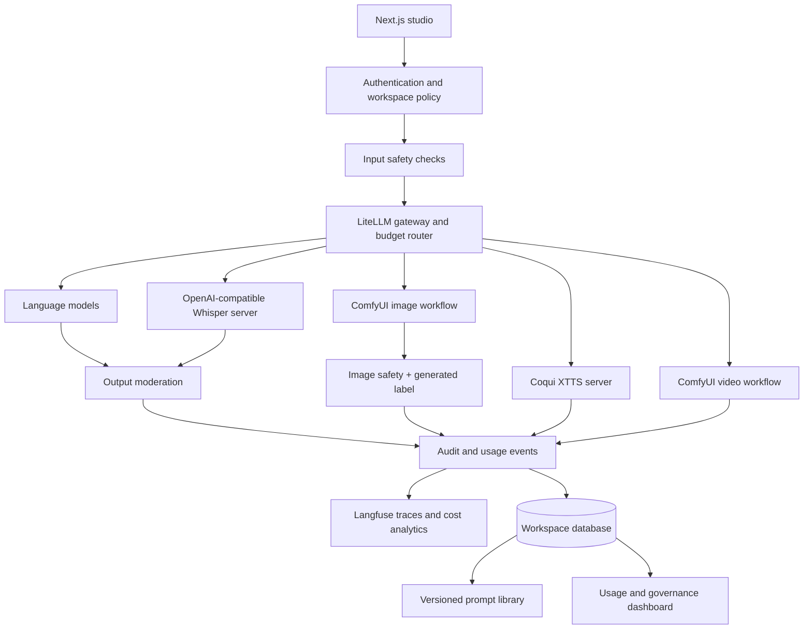

# Architecture and API notes

## Current sign-in and request flow

The API route keeps provider credentials server-side. Login uses one environment-configured account and signs 12-hour HTTP-only cookies; the current configured email and workspace must still match when a cookie is read. Input and output moderation fail closed when a verdict is absent. The guard implementation uses a LiteLLM model alias configured by the operator; validate its exact model format and policy labels against the deployed Llama Guard version before production use. The browser receives a generic gateway error rather than provider response details.

Prompt versions and generation metadata live in `.data/workspace.json` (or the optional `MOSAIC_DATA_DIR`). Writes use a temporary file and atomic rename, with in-process serialization. This local store is not suitable for multi-process or serverless deployment.

## Multimodal integration flow

The app includes adapters for these media paths, but each returns an actionable setup message until its local service and workflow are configured. Image output requires a vision-capable LiteLLM alias. Video output currently checks the text prompt but does not run sampled-frame moderation.

## API contract

### `POST /api/generate`

- Input: JSON object with `modality: "text"` and non-empty `prompt` (maximum 4,000 characters).
- Auth: valid signed session cookie required. The local MVP supports a single environment-configured account; replace it with managed identity and workspace role checks before deployment.
- Safety order: input guard → generation → output guard → return. Missing guard verdicts withhold generation output.
- Success: text, elapsed server latency, a safety pass marker, and gateway-reported token usage when available. Only safety-cleared responses are persisted to activity history.
- Errors: `400` invalid input, `401` missing session, `422` moderation rejection, `502` gateway or safety service failure, `503` missing configuration, `504` timeout.

### Media routes

- `POST /api/media/render`: accepts `{modality: "image" | "video", prompt}`. It runs the ComfyUI API-format workflow named by `COMFYUI_IMAGE_WORKFLOW_PATH` or `COMFYUI_VIDEO_WORKFLOW_PATH`. The prompt is inserted into the configured `*_PROMPT_NODE_ID`. Image results require `LITELLM_IMAGE_GUARD_MODEL` and fail closed when the visual verdict is missing or unsafe.
- `POST /api/media/transcribe`: accepts a multipart `file` up to 25 MB and forwards it to `WHISPER_BASE_URL/v1/audio/transcriptions`; transcript text is moderated before return.
- `POST /api/media/speech`: accepts `{text, voice?}` and sends text to the Coqui XTTS `/studio_speakers` and `/tts` endpoints after input moderation.
- `GET /api/media/{id}`: serves authenticated generated media from `.data/media/` with `X-AI-Generated: true`.

Prompt text and versions plus generation metadata are persisted locally. Traces and costs are not yet captured. Do not use the current dashboard for billing or operational reporting.
